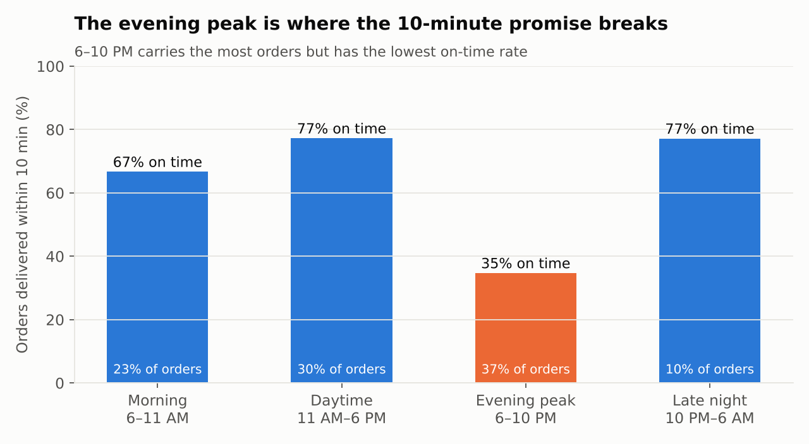
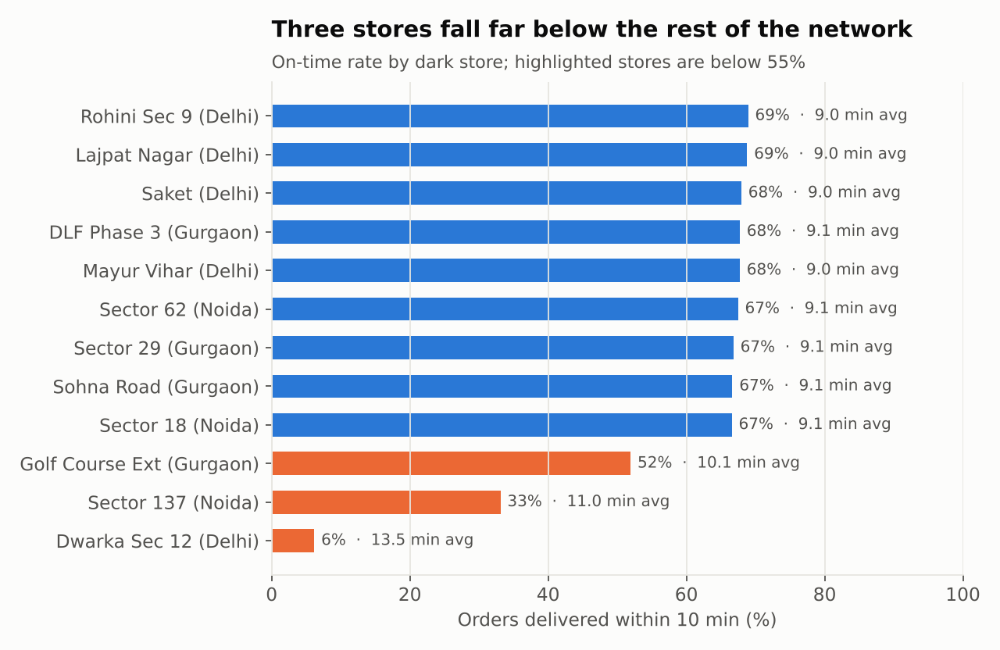
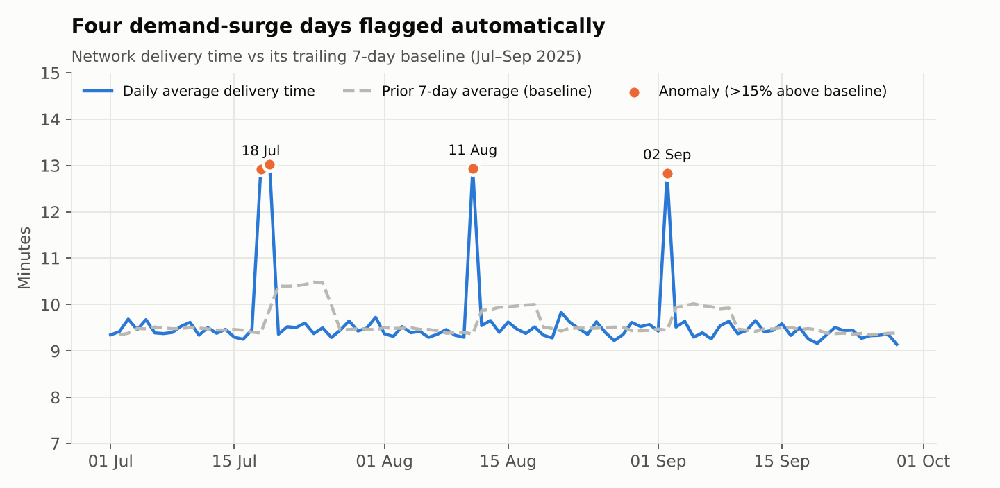
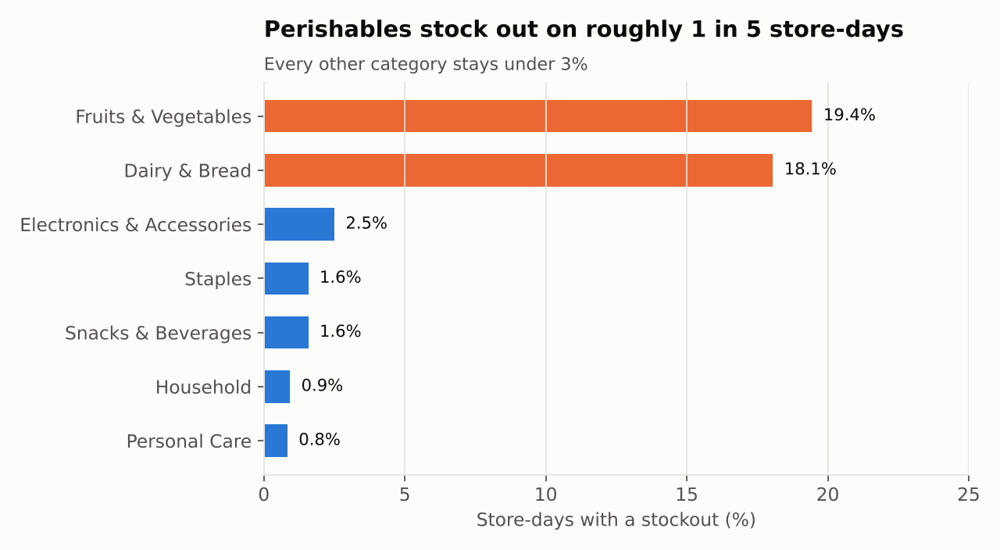
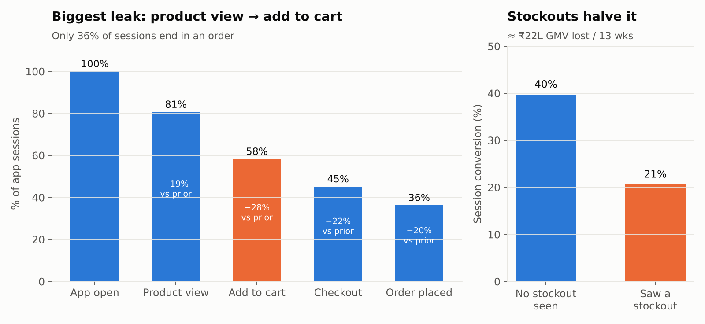
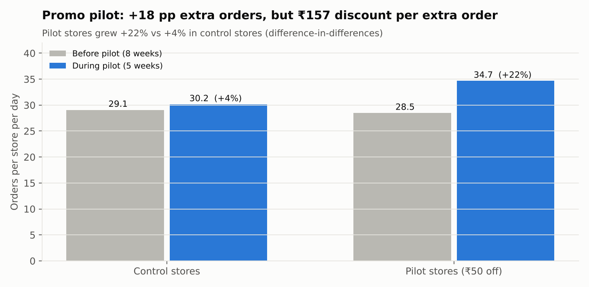

# Quick-Commerce Operations & Funnel Analytics (SQL)

**Question:** A 10-minute grocery delivery business is growing, but some customers get late or incomplete orders, and a discount pilot is running. Where is the business losing orders and money, and what should each team do about it?

**Approach:** 13 SQL queries on 31,000+ orders, 86,000+ app sessions and daily inventory for 12 dark stores in Delhi NCR (Jul–Sep 2025), turned into rupee impact and a prioritised action plan.

> **Data disclosure:** The dataset is **synthetic**. It was generated by `generate_data.py` (seeded, fully reproducible) to mirror quick-commerce operations. No real company or customer data is used.

---

## The 30-second version

| | Finding | Why it matters |
|---|---|---|
| 💸 | **Stockouts cost ≈ ₹22 lakh of GMV in 13 weeks** | A customer who sees an out-of-stock item converts at 21%, against 40% otherwise |
| ⏱️ | **The 6–10 PM peak delivers only 35% of orders on time** | It is the busiest slot, with 37% of all orders |
| 🏪 | **3 of 12 stores fall well behind; one is on time just 6% of the time** | A capacity problem at specific stores, not a network-wide one |
| 🎯 | **The promo pilot added +18 pp orders, at ₹157 of discount per extra order** | Scale it only if the margin per order covers ₹157; otherwise target it |

**Top recommendation:** fix perishable replenishment first. It is the one change that improves availability, conversion, cancellations and missing-item complaints at the same time.

---

## How I approached it

```
1. Validate data  →  2. Build KPIs  →  3. Find where it breaks  →  4. Find why  →  5. Size it in ₹  →  6. Recommend owner + KPI
   (Q1)               (Q2, Q9)          (Q3, Q4, Q5, Q11)            (Q6, Q7, Q12)    (Q8, Q13)          (summary table)
```

**Metric definitions used throughout**
- **On-time %:** share of delivered orders that arrive within the 10-minute promise
- **Defect rate:** delivered orders with a missing, damaged or wrong item ÷ delivered orders
- **Inventory turns (monthly):** units sold ÷ average inventory, scaled to 30 days
- **Session conversion:** app sessions that end in an order ÷ all app sessions
- **Incremental orders (promo):** pilot-store orders minus what those stores would have done at the control group's growth rate (difference-in-differences)

---

## Findings

### 1. The evening peak is where the 10-minute promise breaks



The 6–10 PM slot carries the largest share of orders (37%) but has the lowest on-time rate (35%), against 77% during the day and late at night. Average delivery time rises from 8.5 to 11.1 minutes.
**So what:** this is a rider-capacity problem tied to time of day. The fixes are rider shifts and pre-packing, not new stores. *(Query Q4)*

### 2. Three stores are well behind the rest of the network



Nine stores cluster at 67–69% on time. Golf Course Ext (52%), Sector 137 (33%, a store opened recently and still ramping up) and Dwarka Sec 12 (6%) are clear outliers. Dwarka's defect rate is normal, so orders are picked correctly but delivered late.
**So what:** audit rider count and catchment radius at these three stores before taking any network-wide action. *(Query Q3)*

### 3. Demand-surge days are caught automatically



A 7-day rolling baseline flags 4 days when delivery time ran 32–38% above normal. Order volume rose on the same days, which points to demand surges (for example, rain) rather than store failures.
**So what:** turn this query into a daily alert that triggers standby rider pools. *(Query Q5)*

### 4. Perishables stock out on about 1 in 5 store-days



Fruits & Vegetables and Dairy & Bread turn about 39 times a month, three times faster than other categories, and stock out on 18–19% of store-days. Every other category stays under 3%. Orders with a stocked-out item in the basket are cancelled 3x as often (3.0% vs 1.0%) and have 3.7x more missing-item complaints (2.7% vs 0.7%).
**So what:** perishables need more replenishment cover; the current level does not match their turnover. *(Queries Q6, Q7)*

### 5. The biggest funnel leak is product view → cart, and stockouts drive it



Only 36% of app sessions end in an order. The largest drop (−28%) is between viewing a product and adding it to the cart. Sessions where the customer saw a stockout convert at 21%, against 40% for sessions that didn't. Device and new-vs-returning gaps are under 2 pp, so app design is not the main issue.
**Size of the problem:** ≈ 2,900 lost orders ≈ **₹22 lakh GMV in 13 weeks.** *(Queries Q11, Q12, Q13)*

### 6. The promo pilot works on volume; the economics are the open question



Pilot stores grew orders per store per day by 22%, against 4% in control stores: about 870 incremental orders. The ₹50 discount was also given on orders that would have happened anyway, so the real cost is **₹157 of discount per extra order**, about 21% of the average order value.
**So what:** don't roll it out to everyone. Scale it only if contribution margin per order exceeds ₹157, or target it at Occasional customers, whose 30-day repeat rate is 37% against 71% for Regular customers. *(Queries Q8, Q10, Q13)*

---

## Recommendations

| Priority | Problem | Impact | Action | Owner | KPI to track |
|---|---|---|---|---|---|
| 1 | Perishable stockouts cut conversion from 40% to 21% | ≈ ₹22L GMV lost in 13 weeks | Raise perishable replenishment cover; show substitutes in-app when an item is out of stock | Category + Supply chain | Stockout-day %, view-to-cart % |
| 2 | Evening peak on time 35% vs 77% off-peak | 37% of all orders are exposed | Add rider shifts 6–10 PM; pre-pack top SKUs before the peak | Operations | Peak on-time %, avg delivery minutes |
| 3 | 3 stores well behind the network (6–52% on time) | Weakest stores; risk to repeat rate | Audit rider capacity and catchment radius at each store | City operations | Store on-time %, weekly rank |
| 4 | Promo costs ₹157 of discount per extra order | ₹1.36L discount for ₹6.55L incremental GMV | Scale only if margin covers ₹157; retarget at Occasional customers | Growth / Marketing | Cost per incremental order, 30-day repeat |
| 5 | Demand-surge days run 32–38% slower | 4 days in 13 weeks | Daily alert at +15% vs the 7-day baseline; standby rider pool | Operations | Anomaly days per month |

**Assumptions and limits:** the data is synthetic. Lost GMV assumes sessions that saw a stockout would otherwise convert at the no-stockout rate. The promo baseline applies the control group's growth (+3.7%) to pilot stores. The discount is ₹50 per redemption. Contribution margin is not in the data, so the promo decision is framed as a margin threshold.

---

## The SQL

| # | Business question | Techniques |
|---|---|---|
| Q1 | Is the data clean enough to report on? | `UNION ALL` checks, `LEFT JOIN … IS NULL`, clean view with `ROW_NUMBER()` dedup |
| Q2 | Weekly KPI feed: orders, GMV, AOV, on-time %, defect %, cancel % | Conditional aggregation, date bucketing |
| Q3 | Which stores miss the 10-minute promise? | CTE, `RANK() OVER` on two metrics |
| Q4 | When during the day does delivery break down? | `CASE` time slots, `SUM() OVER ()` share of total |
| Q5 | Which days were anomalies? | Rolling average, `ROWS BETWEEN 7 PRECEDING AND 1 PRECEDING` |
| Q6 | Do stockouts drive cancellations and defects? | Join on store + date + basket category |
| Q7 | Inventory turns and stockout exposure by category | Aggregation on daily inventory snapshots |
| Q8 | Did the promo pilot work? | Difference-in-differences: pilot vs control, before vs during |
| Q9 | Week-over-week growth by city | `LAG() OVER (PARTITION BY city …)` |
| Q10 | Do new customers come back within 30 days? | Chained CTEs, first-order logic, date arithmetic |
| Q11 | Where do users drop out of the app funnel? | Stage CTE, `FIRST_VALUE`, `LAG` for step conversion |
| Q12 | Which segment leaks most? | Multi-dimension segmentation, `NULLIF` safe division |
| Q13 | What is each problem worth in ₹? Does the promo pay back? | Counterfactual baseline, cross-joined CTE aggregates |

**Example: anomaly detection with a rolling window (Q5)**
```sql
WITH daily AS (
    SELECT DATE(order_ts) AS day, AVG(delivery_minutes) AS avg_min
    FROM clean_orders GROUP BY day
)
SELECT day, avg_min,
       AVG(avg_min) OVER (ORDER BY day ROWS BETWEEN 7 PRECEDING AND 1 PRECEDING) AS prior_7d_avg
FROM daily;   -- rows deviating >15% from prior_7d_avg are flagged
```

---

## Data model

| Table | Rows | One row is |
|---|---|---|
| `stores` | 12 | A dark store (city, zone, open date, promo-pilot flag) |
| `customers` | 10,300 | A customer (home store, signup date, segment) |
| `orders` | 31,365 | An order (timestamp, basket categories, value, promo, status, delivery minutes, defect) |
| `inventory_daily` | 7,560 | Store × category × day (opening/closing units, units sold, stockout hours) |
| `app_sessions` | 86,410 | An app session (device, stockout seen, furthest funnel stage reached) |

## How to run

```bash
python3 generate_data.py           # builds qcommerce.db (SQLite)
sqlite3 qcommerce.db < queries.sql # runs all 13 queries
python3 make_charts.py             # rebuilds the six chart PNGs (needs matplotlib)
```

## Files

- `queries.sql`: all 13 queries plus the clean-data view
- `results.txt`: the output of every query
- `1_…png` to `6_…png`: the six charts used in this README
- `generate_data.py`: synthetic data generator (seeded)
- `make_charts.py`: chart builder (matplotlib)
- `qcommerce.db`: the SQLite database
